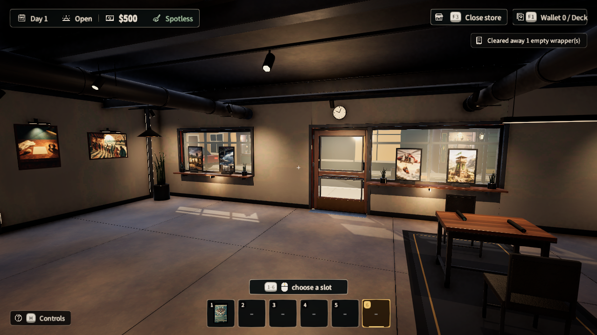
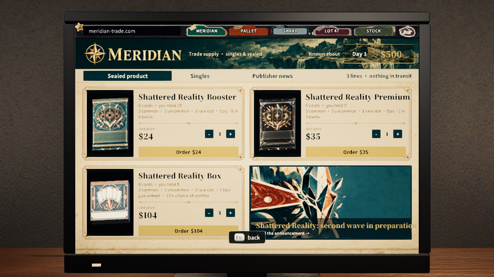
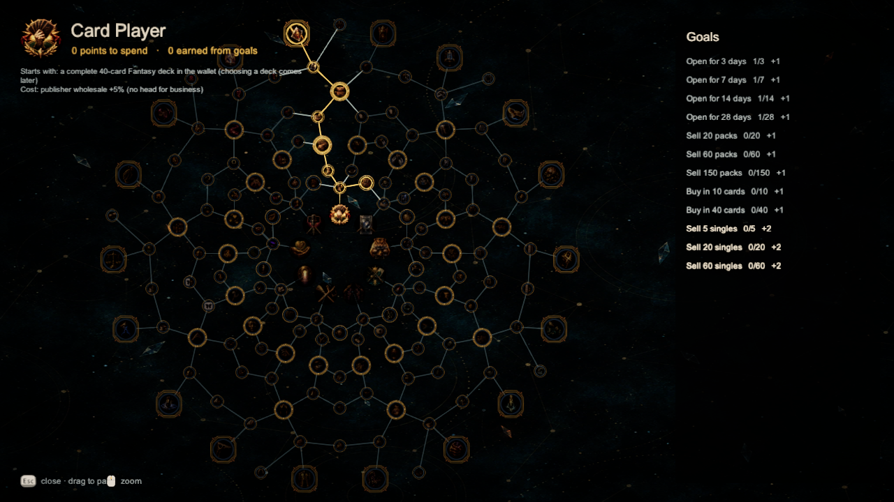
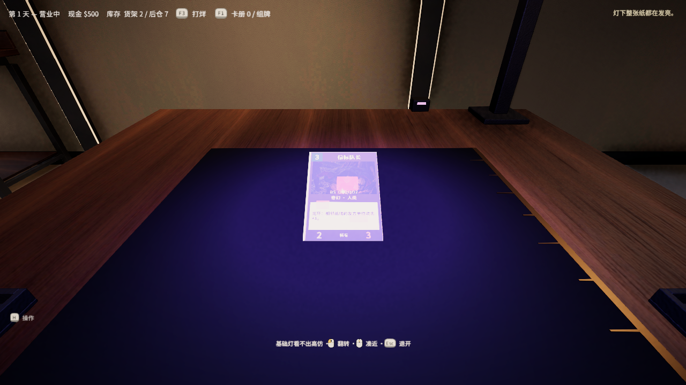

# ShufflingRift — *Shattered Reality*  — Portfolio Showcase

**English** · [简体中文](README.zh-CN.md)

> *A card shop, and the street around it.*

A first-person trading-card-shop simulation built in Unity 6 (URP, C#). You buy cards from sellers, inspect them for forgeries, negotiate prices, open packs, display and sell stock — and play the game's built-in card game against customers at physical tables.

**This repository is a showcase only.** It contains screenshots, a trailer, and architecture and process notes. It does not contain the full source code, third-party art, or the original Git history.

| | |
|---|---|
| Engine | Unity 6000.0.37f1, URP |
| Language | C# |
| Genre | First-person · management sim · social strategy · built-in TCG |
| Status | Playable single-player build, under continued iteration |
| Automated tests | 259 EditMode tests, plus PlayMode evidence tests that render and capture real frames |
| UI languages | English / 简体中文 (switchable in Settings) |

## Gameplay at a glance

- **Every card is one unique physical asset.** A card carries its market value, condition, authenticity, ownership and location together. There is no separate "inventory database" and "real object" to drift apart.
- **Information is the gameplay.** The game never prints "authentic / mint / $483" next to a card. You judge with a loupe, a UV lamp, the market computer, and what the seller tells you.
- **Buying negotiations.** Sellers claim "authentic, graded X". You cross-examine with claim cards — doubt authenticity, doubt the grade, quote market prices, haggle, or read the person. Accuse an expert wrongly and your reputation takes the hit.
- **A street, not just a shop.** Wholesale sites, a pawn shop that buys scrap, fishing and a tackle shop, a drinks corner, multiple play tables and in-store tournaments.
- **A built-in TCG, *Shattered Reality*.** Four lanes, energy and shared directional fragments; duel NPCs on physical tables.
- **Personas and a talent web.** Nine personas, a 160-node talent web, and a different starting kit and trade-off for each persona.

### Screenshots

| | |
|---|---|
|  The shop floor |  Buying negotiation |
|  In-game computer: wholesale site |  Talent web |
|  The pawn shop across the road |  Checking a card under UV |
|  Built-in card game (prototype UI) | |

### Trailer

Full trailer (2 min 03 s · 1080p · 27 MB, with music): [`media/trailer-1080p.mp4`](media/trailer-1080p.mp4). GitHub does not play repo videos inline — open it and choose *Download raw file*.
The trailer was cut automatically from my own gameplay recording with [`tools/make_trailer.py`](tools/make_trailer.py) (ffmpeg). The captions are English; the footage was recorded with the in-game Chinese UI, and the game itself can be switched to English in Settings.

## What I did, and what the AI did

I want to be transparent about how this project is built:

- **I own:** game design and trade-offs, system rules and the direction of the numbers, acceptance criteria, playtesting and feedback, and the final call on every design decision (recorded in a decision log).
- **AI-assisted:** most code was written by AI coding agents (Claude Code, Codex) working from my design documents, task contracts and test gates. Concept art is AI-generated; 3D models are built through Blender scripts (including Blender MCP).
- **Process:** settle the design in conversation → write it into a frozen spec → split into atomic tasks → automated compile and tests → screenshot evidence → my hands-on acceptance. Details in [docs/Development.md](docs/Development.md).

## Documentation

- [docs/Architecture.md](docs/Architecture.md) — modules and data flow
- [docs/Development.md](docs/Development.md) — workflow, my contributions, how it is tested
- [docs/Credits.md](docs/Credits.md) — third-party assets and licensing

## Contact

GitHub: [@lasersoldier](https://github.com/lasersoldier)
