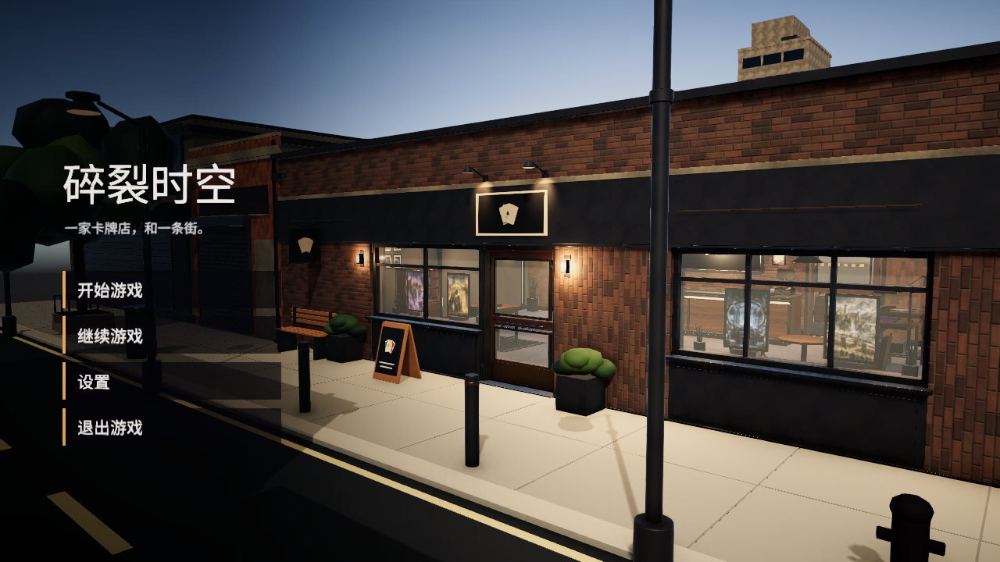
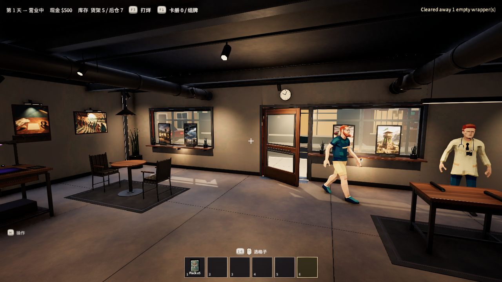
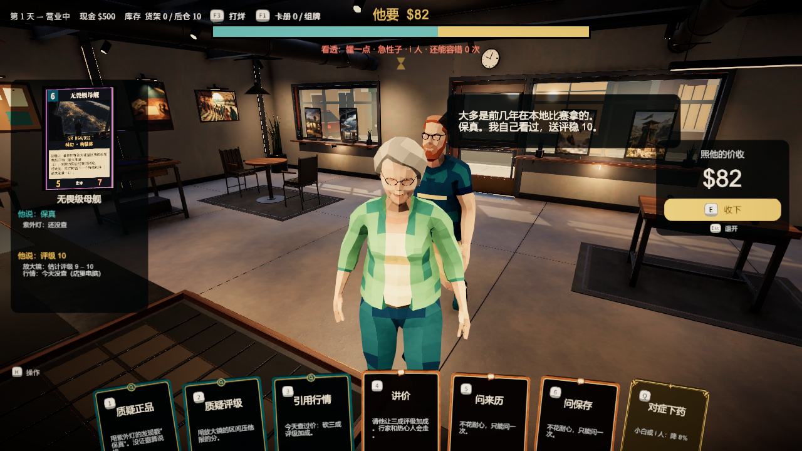
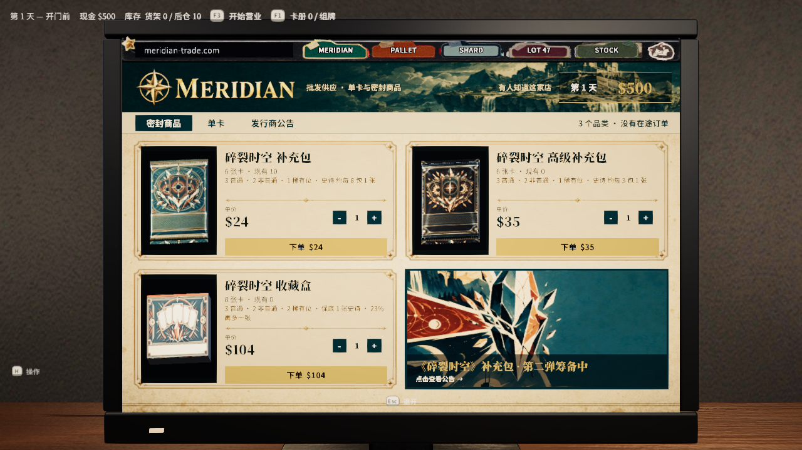
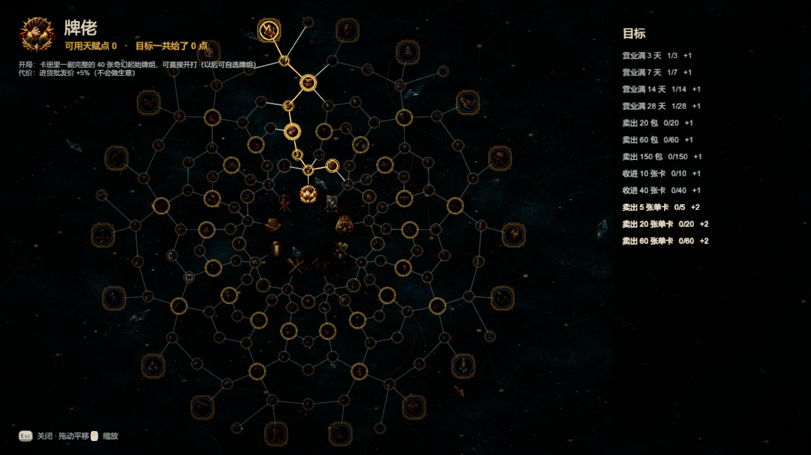
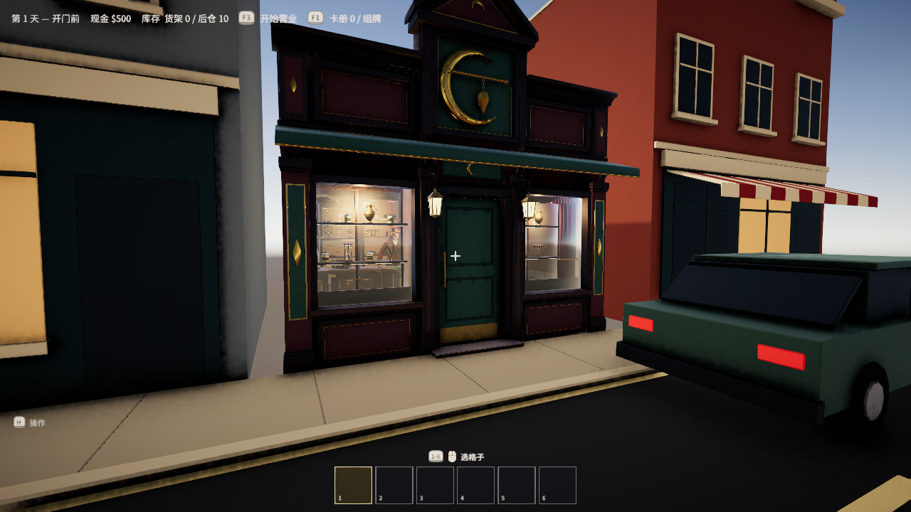
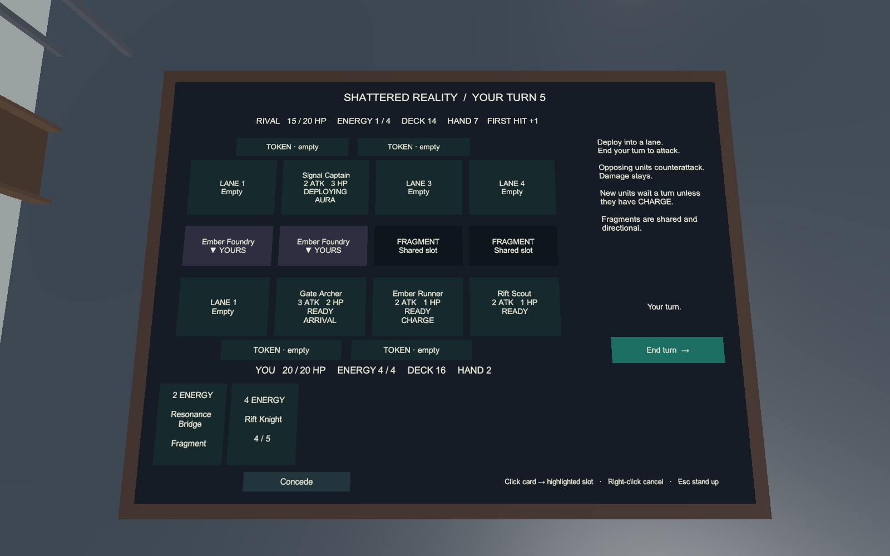
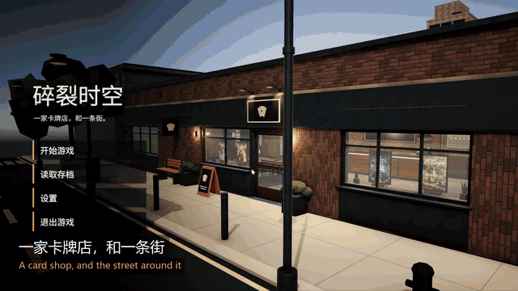

# ShufflingRift（碎裂时空）— Portfolio Showcase

**[English](README.md)** · 简体中文

> 一家卡牌店，和一条街。 / *A card shop, and the street around it.*

一款第一人称的 TCG 卡牌店经营模拟游戏（Unity 6 / URP / C#）。你收卡、验真假、谈价、开包、陈列、出售，并在店里用游戏内置的卡牌对战系统和顾客打牌。

**本仓库只是展示用途**：包含截图、玩法与架构说明、开发流程记录，不包含完整源码、第三方美术资源或原项目的 Git 历史。

| | |
|---|---|
| 引擎 | Unity 6000.0.37f1，URP |
| 语言 | C# |
| 类型 | 第一人称 · 经营模拟 · 社交策略 · 内置 TCG |
| 状态 | Vertical Slice 之后持续迭代中，单人模式可玩 |
| 自动化测试 | EditMode 259 项 + 多个 PlayMode 证据测试 |
| 界面语言 | 简体中文 / English |

## 玩法概览

- **每张卡都是唯一的实体资产。** 一张卡同时拥有市场价、品相、真假、所有权和位置，不存在“库存数据库”和“实物”两套数据。
- **信息本身就是玩法。** 系统不会在卡面旁标注真假和价格。玩家要用放大镜、紫外灯、行情电脑和顾客的话来自己判断。
- **收卡谈判。** 卖家会报“保真 + 送评 X 分”，玩家通过质疑正品、质疑评级、引用行情、讲价、对症下药等“说法卡”交叉询问，冤枉行家会扣口碑。
- **一条街的生态。** 批发网站、废品回收与当铺、钓鱼与渔具店、饮料角、多张对战桌与店内赛事。
- **内置 TCG《碎裂时空》。** 4 路战线、能量、碎片（Fragment）等规则，可与 NPC 顾客在实体牌桌上对战。
- **人格与天赋网。** 九种人格，160 节点的天赋网，每个人格有独特开局与代价。

### 截图

| | |
|---|---|
|  店内营业 |  收卡谈判 |
|  游戏内电脑：批发网站 |  天赋网 |
|  街对面的当铺 |  紫外灯验卡 |
|  内置卡牌对战（原型界面） | |

### Demo 视频

完整预告片（2 分 03 秒 · 1080p · 27 MB，带配乐）：[点此下载 / 观看 `trailer-1080p.mp4`](media/trailer-1080p.mp4)。在 GitHub 页面点开后选择 *Download raw file* 即可用本地播放器播放。
预告片由我的真实游玩录屏用 [`tools/make_trailer.py`](tools/make_trailer.py)（ffmpeg）自动剪辑生成。

## 我做了什么，AI 做了什么

我对此项目的开发方式保持透明：

- **我负责：** 游戏设计与取舍、系统规则与数值方向、验收标准、玩法试玩与反馈、所有设计决策的最终确认（记录在 `DECISIONS` 决策日志中）。
- **AI 辅助：** 代码实现主要由 AI 编码代理（Claude Code、Codex）在我设定的设计文档、任务契约和测试门槛下完成；概念图由 AI 生成；3D 模型通过 Blender 脚本（含 Blender MCP）构建。
- **流程：** 先在对话中确定玩法设计 → 写入冻结的设计规格 → 拆成原子任务 → 自动化编译与测试 → 截图证据 → 我实机验收。详见 [docs/zh-CN/Development.md](docs/zh-CN/Development.md)。

## 文档

- [docs/zh-CN/Architecture.md](docs/zh-CN/Architecture.md) — 功能模块与数据流
- [docs/zh-CN/Development.md](docs/zh-CN/Development.md) — 开发流程、个人贡献与测试方法
- [docs/zh-CN/Credits.md](docs/zh-CN/Credits.md) — 第三方资源与版权说明

## English summary

ShufflingRift is a first-person trading-card-shop simulation built in Unity 6 (URP, C#). You buy cards from sellers, inspect them for forgeries (loupe, UV light, market computer), negotiate, open packs, display and sell, and play an in-game TCG against NPC customers at physical tables. Every card is a single unique world asset carrying price, condition, authenticity, ownership, and location.

This repository is a **portfolio showcase only**: screenshots, architecture and process docs. It does not contain the full source, third-party art, or the original Git history. Development was AI-assisted (Claude Code, Codex); I own the game design, decisions, acceptance and playtesting. See [docs/zh-CN/Development.md](docs/zh-CN/Development.md) for the exact split.

## 联系 / Contact

GitHub: [@lasersoldier](https://github.com/lasersoldier)
